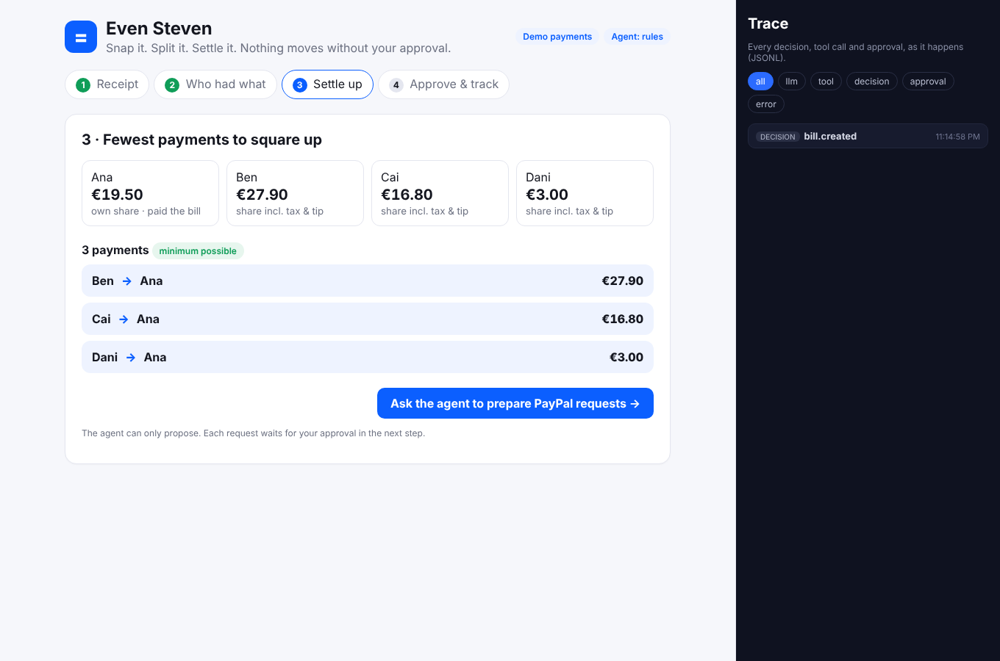

# Even Steven

**Snap a receipt, split each item fairly, and send PayPal requests with the fewest payments needed. Nothing moves without your approval, and every decision is logged.**

Built for the PayPal AI Hackathon (sandbox only).



## What it does
1. **Reads the receipt** — a vision LLM turns a photo into line items, tax, tip and total. You correct anything on screen; if the lines don't add up to the total, you can't continue (no silent fixes).
2. **Who had what** — tap people onto each item; shared dishes split evenly, tax and tip in proportion to what each person ordered. All money is integer cents, rounded with the largest-remainder method, so shares always add up to the exact total.
3. **Fewest payments** — net balances, then the minimum number of transfers (greedy, checked against an exact solver for groups up to 8).
4. **Agent proposes, you approve** — an agent prepares one PayPal invoice per debtor (and reminders for unpaid ones after N days). Its tools can only *propose*: each action waits in an approval queue, and guardrails reject wrong amounts, people who owe nothing and duplicates. Only after you approve does the server send it through the **PayPal Agent Toolkit** (sandbox invoicing: create, send, remind, status, cancel).
5. **Trace panel** — every LLM call, tool call, guardrail, approval and PayPal response is written to `traces/<bill>.jsonl` and shown live.

## Run it (2 minutes, no keys)
```bash
git clone https://github.com/isaacboque/even-steven && cd even-steven
npm install
npm run build && npm start        # http://localhost:8787
```
Default `DEMO_MODE=mock` uses an in-memory PayPal stand-in with the same approval and idempotency rules, sample receipts and a "skip days" button to demo reminders.

For development: `npm run dev` (API on 8787 + Vite on 5173).

## Run it against the PayPal sandbox
1. In the [PayPal Developer Dashboard](https://developer.paypal.com/dashboard/) create a sandbox app (its business account is the person who paid the bill) and note two **sandbox personal** accounts for the friends.
2. `cp .env.example .env` and set `DEMO_MODE=paypal`, `PAYPAL_CLIENT_ID`, `PAYPAL_CLIENT_SECRET`, `CURRENCY`, and an LLM key (`LLM_PROVIDER` = `google` | `openai` | `anthropic` + its key; optional `LLM_MODEL`). Use a key with a spend cap.
3. `npm run smoke:sandbox` — creates, sends, reads and cancels one 1.00 invoice to `SMOKE_DEBTOR_EMAIL`.
4. `npm run build && npm start`, upload a receipt photo, put the sandbox emails on the people, approve the requests, and pay one from the sandbox personal account. The status turns to *paid*.

Sandbox access tokens expire after a few hours; the gateway rebuilds the toolkit client every 45 minutes and once more on an auth error.

## Evaluation
`npm run eval` runs 20 deterministic scenarios (2–8 people, shared items, tax, tip, retries, attempts without approval, reminders at day 0/3/7 on a simulated clock) and checks: shares sum to the total with no cent lost · transfers equal the exact minimum · balances settle to zero · no duplicate request after retries · nothing is sent without approval · reminders only for unpaid requests past the threshold. It also runs in CI.

<!-- eval:start -->
**20/20 scenarios pass all checks.**

| Scenario | Setup | Transfers | sumsToTotal | minimalTransfers | settlesToZero | noDuplicates | approvalEnforced | remindersCorrect |
|---|---|---|---|---|---|---|---|---|
| S01 | 2 people, 2 items, tax, tip | 1 | ✅ | ✅ | ✅ | ✅ | ✅ | ✅ |
| S02 | 3 people, 5 items | 2 | ✅ | ✅ | ✅ | ✅ | ✅ | ✅ |
| S03 | 4 people, 9 items | 3 | ✅ | ✅ | ✅ | ✅ | ✅ | ✅ |
| S04 | 5 people, 6 items, tax | 4 | ✅ | ✅ | ✅ | ✅ | ✅ | ✅ |
| S05 | 6 people, 5 items, tip | 5 | ✅ | ✅ | ✅ | ✅ | ✅ | ✅ |
| S06 | 7 people, 7 items | 6 | ✅ | ✅ | ✅ | ✅ | ✅ | ✅ |
| S07 | 8 people, 6 items, tax | 6 | ✅ | ✅ | ✅ | ✅ | ✅ | ✅ |
| S08 | 2 people, 9 items | 1 | ✅ | ✅ | ✅ | ✅ | ✅ | ✅ |
| S09 | 3 people, 2 items, tip | 1 | ✅ | ✅ | ✅ | ✅ | ✅ | ✅ |
| S10 | 4 people, 9 items, tax | 3 | ✅ | ✅ | ✅ | ✅ | ✅ | ✅ |
| S11 | 5 people, 7 items | 4 | ✅ | ✅ | ✅ | ✅ | ✅ | ✅ |
| S12 | 6 people, 4 items | 4 | ✅ | ✅ | ✅ | ✅ | ✅ | ✅ |
| S13 | 7 people, 7 items, tax, tip | 6 | ✅ | ✅ | ✅ | ✅ | ✅ | ✅ |
| S14 | 8 people, 4 items | 5 | ✅ | ✅ | ✅ | ✅ | ✅ | ✅ |
| S15 | 2 people, 3 items | 1 | ✅ | ✅ | ✅ | ✅ | ✅ | ✅ |
| S16 | 3 people, 7 items, tax | 2 | ✅ | ✅ | ✅ | ✅ | ✅ | ✅ |
| S17 | 4 people, 6 items, tip | 3 | ✅ | ✅ | ✅ | ✅ | ✅ | ✅ |
| S18 | 5 people, 4 items | 4 | ✅ | ✅ | ✅ | ✅ | ✅ | ✅ |
| S19 | 6 people, 4 items, tax | 5 | ✅ | ✅ | ✅ | ✅ | ✅ | ✅ |
| S20 | 7 people, 7 items | 6 | ✅ | ✅ | ✅ | ✅ | ✅ | ✅ |
<!-- eval:end -->

## Tests
`npm test` — 38 Vitest tests, all offline (mocked LLM via the AI SDK test models, fake PayPal tools): money and rounding properties, split, settlement vs exact optimum on 200 random groups, approval gate, idempotency, PayPal response parsing, the full API flow, and the LLM agent's guardrails with a scripted model.

## Architecture
```
src/core/      money (cents, largest remainder), split, settle (greedy + exact)
src/receipt/   ReceiptReader: FixtureReader, VisionReader (AI SDK, structured output + total check)
src/approval/  approval queue (pending → approved/rejected → executed)
src/gateway/   PaymentsGateway: MockGateway, PayPalGateway (PayPal Agent Toolkit invoicing)
src/agent/     agent tools (propose only) + LLM agent + rules fallback
src/trace/     JSONL tracer
src/server/    Hono API      web/  React UI      src/eval/  scenarios + runner
```

## AI tools used
- **Product:** a vision LLM through the Vercel AI SDK (provider chosen by env) reads receipts and drives the agent; the PayPal Agent Toolkit provides the PayPal tools.
- **Building it:** Claude (planning, specs) and Claude Code (implementation, tests). Every change went through CI (typecheck, tests, eval, build).

## Limits
Sandbox only · one currency per bill · single-page receipts · no login (local demo).

## License
MIT
